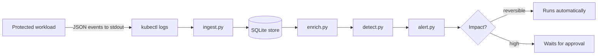

# Detection Lab

A detection and enrichment pipeline for AI agent session theft, built around a small
protected workload.

The workload exists to be attacked. It issues sessions, serves requests, holds something
sensitive, and can send data to an external destination. It also stores live session
tokens in a plaintext file, on purpose, because that is how real agent tooling has leaked
sessions. The pipeline's job is to notice when a session is being used by someone it was
never issued to.

## How it works



Each stage does one thing. `ingest` separates events from log noise and counts what it
skips. `enrich` adds the context needed to judge an event. `detect` applies rules and
scores them. `alert` groups findings into one alert per session and decides what may be
done about it.

## What it catches

A session is issued to one device, then used from another to export data to a domain
nobody approved. The pipeline produces this:

```
[HIGH] Suspected session compromise
  User     : alice
  Session  : d8880d7fd2a9806c
  Score    : 13

  Why this was raised
    - Session was issued to device 12cab5095b37 at 81.2.69.160, but this request
      came from device ffee99887766 at 203.0.113.77.  [session.device_mismatch]
    - Data was sent to paste-example.net, which is not on the approved
      destination list.  [export.unapproved_destination]
    - First time alice has been seen from 203.0.113.77.  [session.new_address]
    - A sensitive action on a session issued 1.1 hours earlier.  [session.stale_use]

  Response
    [done] collect_evidence (reversible impact)
    [NEEDS APPROVAL] revoke_session (high impact)
    [NEEDS APPROVAL] block_destination (high impact)
```

No single rule made that call. The device mismatch alone scores 5, which is medium. The
combination is what makes it high.

## Design decisions worth explaining

**Events never contain tokens.** Each event carries an HMAC of the session token, so
sessions can be correlated across events without the log becoming a credential store.
The key means someone holding a stolen token still cannot find it in the logs.

**The application does not decide what is suspicious.** It records facts. Detection needs
correlation across many events and sources, rules change far more often than the
application does, and a compromised service cannot be trusted to report on itself.

**Ingestion is idempotent by construction.** Every event's id is derived from its own
content and used as the primary key, so re-reading a log changes nothing. No memory of
previous runs is required.

**Enrichment is separate from events.** The events table is an immutable record of what
arrived. Derived context lives in its own table, carries the version of the enricher that
produced it, and can be recomputed without touching the original.

**Rules are separate from scoring.** A rule says something happened. The weight says how
much it matters. Changing importance does not mean rewriting detection.

**Findings explain themselves.** An alert saying "risk score 13" tells an analyst nothing.
Each finding carries a sentence naming what was observed and why it is odd.

**Detection confidence is not response authority.** Reversible work runs automatically.
Anything that ends a real person's session or blocks traffic for everyone waits for a
named human, and the decision is recorded against that action and never overwritten by a
later pipeline run.

**One rule is deliberately bad.** `sensitive_read_then_export` describes a genuine
exfiltration pattern and also describes what this application does on every normal run.
It is kept, at the lowest weight, with the output marking it, because a rule that matches
ordinary behaviour is noise with a severity attached.

## Running it

Requires Docker, kind, kubectl and Python 3.12.

```bash
# Build and deploy the workload
docker build -t protected-inference:0.2 .
kind create cluster --name detection-lab
kind load docker-image protected-inference:0.2 --name detection-lab
kubectl apply -f k8s/

# Generate some traffic (two terminals)
kubectl port-forward svc/protected-inference 8000:8000
python scripts/smoke_test.py

# Run the pipeline
kubectl logs deploy/protected-inference | python pipeline/ingest.py -
python pipeline/enrich.py
python pipeline/detect.py
python pipeline/alert.py
```

`LAB_DB` overrides the database path, which is how the tests and the attack simulation
stay away from real data.

## Seeing it catch something

```bash
cp data/events.db data/test.db
LAB_DB=data/test.db python scripts/simulate_theft.py
LAB_DB=data/test.db python pipeline/enrich.py --all
LAB_DB=data/test.db python pipeline/detect.py
LAB_DB=data/test.db python pipeline/alert.py
```

## Testing

```bash
python tests/test_detection.py
```

Eleven checks, in three groups: clean data stays quiet, a planted theft is caught, and
nothing high impact executes without approval. It exits non-zero on failure, so it works
as a CI gate or a scheduled canary.

That last use is the point. A detector that has produced nothing for a month is either
sitting in a quiet month or quietly dead, and those look identical from outside. Running
a known attack on a schedule and requiring a finding is how you tell them apart.

To prove the test has teeth, break `rule_device_mismatch` in `pipeline/detect.py` and run
it again. Nine of eleven, exit code 1.

## What this is not

Execution is simulated. There is no identity provider to revoke against, so approved
actions print what they would do. The control flow is the deliverable, not the side
effect.

The device fingerprint is a hash of address and user agent, which a determined attacker
copies trivially. It is enough to catch opportunistic session replay, which is what
infostealers actually produce, and not enough for a targeted adversary.

SQLite is the right choice at this size and the wrong one at scale. At meaningful volume
the store becomes an append-only event store with a proper database behind it, enrichment
becomes a queue of workers rather than a batch pass, and detection moves to streaming so
latency stops depending on how recently someone ran a script.