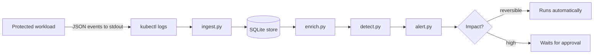

# Detection Lab

A detection and enrichment pipeline for AI agent session theft, built around a small
protected workload.

The workload exists to be attacked. It issues sessions, serves requests, holds something
sensitive, and can send data to an external destination. It also writes live session
tokens to a plaintext file, deliberately, because that is how agent tooling has leaked
sessions in practice. The pipeline's job is to notice when a session is being used by
someone it was never issued to, explain why it thinks so, and stop short of taking
irreversible action on its own authority.

---

## Contents

- [How it works](#how-it-works)
- [What it catches](#what-it-catches)
- [Repository layout](#repository-layout)
- [The event schema](#the-event-schema)
- [The data model](#the-data-model)
- [Enrichment](#enrichment)
- [Detection rules and scoring](#detection-rules-and-scoring)
- [Alerts and the approval gate](#alerts-and-the-approval-gate)
- [Metrics](#metrics)
- [Running it](#running-it)
- [Seeing it catch something](#seeing-it-catch-something)
- [Testing](#testing)
- [Design decisions](#design-decisions)
- [Troubleshooting](#troubleshooting)
- [What this is not](#what-this-is-not)
- [What would change at scale](#what-would-change-at-scale)

---

## How it works



Each stage does one thing.

| Stage | Responsibility |
| --- | --- |
| `ingest` | Read the log stream, keep valid events, count and explain everything skipped |
| `store` | Give each event a content-derived id and write it once, idempotently |
| `enrich` | Add the context needed to judge an event, without judging it |
| `detect` | Apply rules, produce self-explaining findings, score them |
| `alert` | Group findings per session, propose response, gate the dangerous parts |

---

## What it catches

A session is issued to one device, then used from another to export data to a domain
nobody approved:

```
[HIGH] Suspected session compromise
  User     : alice
  Session  : d8880d7fd2a9806c
  Score    : 13
  Activity : 2026-09-23T18:27:51Z to 2026-09-23T19:36:38Z

  Why this was raised
    - Session was issued to device 12cab5095b37 at 81.2.69.160, but this request
      came from device ffee99887766 at 203.0.113.77.  [session.device_mismatch]
    - Data was sent to paste-example.net, which is not on the approved
      destination list.  [export.unapproved_destination]
    - First time alice has been seen from 203.0.113.77.  [session.new_address]
    - A sensitive action on a session issued 1.1 hours earlier.  [session.stale_use]

  What was touched
    2026-09-23T18:27:51Z  data.export      high  https://example-partner.com/upload
    2026-09-23T19:36:38Z  data.export      high  https://paste-example.net/upload

  Response
    [done] collect_evidence (reversible impact)
    [NEEDS APPROVAL] revoke_session (high impact)
    [NEEDS APPROVAL] block_destination (high impact)
```

No single rule made that call. The device mismatch alone scores 5, which is medium. The
combination is what makes it high.

---

## Repository layout

```
app/
  main.py            The protected workload: login, inference, sensitive read, export
  events.py          Structured event emission, HMAC session hashing, fingerprinting
pipeline/
  ingest.py          Read the log stream, validate, count skips, hand off to the store
  store.py           Schema, content-addressed event ids, idempotent inserts
  enrich.py          Session origin, session age, destination approval, address history
  detect.py          Rules, weights, risk scores, self-explaining findings
  alert.py           Session-level alerts, response actions, approval gate, metrics
  query.py           Five starter queries against the stored events
scripts/
  smoke_test.py      Exercise every endpoint once, verify expected status codes
  simulate_theft.py  Plant a replayed session from a different device
  check_db.py        Diagnostic: which module, which database, which tables
tests/
  test_detection.py  End-to-end assertions over the real pipeline
  fixtures/          A captured sample of real events, used as test input
k8s/                 Deployment and Service manifests
Dockerfile           Non-root container for the workload
```

---

## The event schema

Every request to the workload emits exactly one JSON line to stdout. Kubernetes collects
stdout, which is what makes `kubectl logs` the transport.

```json
{
  "ts": "2026-09-23T18:27:51.120876+00:00",
  "service": "protected-inference",
  "event_type": "data.export",
  "identity": {
    "user": "alice",
    "session_hash": "d8880d7fd2a9806c"
  },
  "context": {
    "client_ip": "81.2.69.160",
    "user_agent": "Mozilla/5.0 (Windows NT 10.0) lab-laptop",
    "fingerprint": "12cab5095b37"
  },
  "action": {
    "method": "POST",
    "path": "/v1/export",
    "status": 202,
    "resource": "account:data",
    "sensitivity": "high",
    "destination": "https://example-partner.com/upload"
  }
}
```

Three parts, because these become the three things the pipeline correlates: **who**
(identity), **from where** (context), and **what they did** (action).

| Event type | Emitted when |
| --- | --- |
| `auth.login` | Credentials accepted, session issued |
| `auth.login_failed` | Credentials rejected |
| `auth.session_rejected` | A request presented an unknown or missing session |
| `session.use` | An authenticated request to the model endpoint |
| `resource.read` | A read of the sensitive resource |
| `data.export` | Data sent to an external destination |

`/healthz` deliberately emits nothing. Kubernetes probes it every few seconds and logging
it would bury the security events in noise.

`session_hash` is an HMAC of the session token, truncated. The token itself never appears
in an event.

### Workload endpoints

| Method | Path | Purpose |
| --- | --- | --- |
| `POST` | `/login` | Issue a session |
| `POST` | `/v1/infer` | Stub model call, requires a session |
| `GET` | `/v1/account/secrets` | The sensitive resource |
| `POST` | `/v1/export` | Send data to an external destination |
| `GET` | `/healthz` | Liveness and readiness, no event emitted |

---

## The data model

Six tables in SQLite. Facts and derived data are kept apart on purpose.

| Table | Holds | Key |
| --- | --- | --- |
| `events` | What arrived, flattened, plus the raw line | `event_id` (sha256 of the canonical event) |
| `enrichment` | Derived context, one row per event | `event_id` |
| `findings` | One row per rule that fired on an event | `finding_id` (sha256 of event and rule) |
| `event_risk` | Total score and severity per event | `event_id` |
| `alerts` | One row per session worth a human's attention | `alert_id` (sha256 of the session) |
| `response_actions` | Proposed actions and their approval state | `action_id` |

Every key is derived from content rather than generated, so re-running any stage produces
the same rows instead of more of them. `events` keeps the original JSON in `raw`, so the
whole pipeline can be reprocessed from what was actually received if the schema changes.

---

## Enrichment

`enrich.py` adds the facts a human would need before judging an event. It decides nothing.

| Field | Meaning |
| --- | --- |
| `session_issued_at` | When the session's login happened |
| `session_issued_fingerprint` | The device the session was issued to |
| `session_issued_ip` | The address the session was issued from |
| `fingerprint_matches_issuer` | Whether this event came from that same device |
| `session_age_seconds` | How old the session was at the moment of this event |
| `destination_domain` | Parsed hostname of any export destination |
| `destination_approved` | Whether that hostname is on the approved list |
| `ip_seen_before_for_user` | Whether this user had used this address before |
| `notes` | Why enrichment was incomplete, when it was |
| `enricher_version` | Which version of the logic produced this row |

Enrichment failures are recorded rather than dropped. A run reports how many rows carry
notes, because an enricher producing nothing looks identical to one with nothing to do.

Re-running only processes events with no enrichment or an older version. `--all` forces a
full recompute.

---

## Detection rules and scoring

`detect.py` runs five rules. Each returns either nothing or a sentence explaining what it
saw.

| Rule | Fires when | Weight |
| --- | --- | --- |
| `session.device_mismatch` | The session is used from a device it was not issued to | 5 |
| `export.unapproved_destination` | Data goes to a hostname not on the approved list | 4 |
| `session.new_address` | First time this user has been seen from this address | 2 |
| `session.stale_use` | A high-sensitivity action on a session older than an hour | 2 |
| `sensitive_read_then_export` | A sensitive read followed by an export within 5 minutes | 1 |

Weights add up to a risk score, and the score maps to a severity band:

| Score | Severity |
| --- | --- |
| 7 or more | high |
| 4 to 6 | medium |
| 1 to 3 | low |
| 0 | none |

Thresholds live together at the top of the file so they can be argued about in one place:
`STALE_SESSION_SECONDS` and `READ_TO_EXPORT_SECONDS`.

**The last rule is deliberately bad and the output marks it as such.** Reading sensitive
data then exporting it is a real exfiltration pattern. It is also exactly what this
application does on every normal run, so it fires on completely innocent traffic every
time. It is kept at the lowest weight as a worked example of the difference between a
rule that describes an attack and a rule that can distinguish one.

The weights are judgements rather than measurements. Making them defensible means
measuring how often each rule's findings turn out to be real, and weighting by that.

---

## Alerts and the approval gate

Findings are per event. Alerts are per session, because an analyst wants one thing to read
about one incident.

Each alert proposes response actions, split by whether they can be undone:

| Action | Impact | Behaviour |
| --- | --- | --- |
| `collect_evidence` | Reversible | Runs automatically |
| `revoke_session` | High | Waits for a named human |
| `block_destination` | High | Waits for a named human |

```bash
python pipeline/alert.py --list-pending
python pipeline/alert.py --approve <action_id> --by "Your Name"
```

Approval records who decided and when. A second approval of the same action is refused,
and later pipeline runs never overwrite a decision a human already made.

Execution is simulated. The control flow is the deliverable.

---

## Metrics

```bash
python pipeline/alert.py --metrics
```

Reports events stored, enrichment coverage, how many enrichment rows carry notes, findings
by rule, events by severity, alerts raised, actions awaiting approval, and mean detection
latency. Because this is a batch pipeline, that latency figure measures how stale the last
run is rather than how fast the system reacts, which is itself worth knowing.

---

## Running it

Requires Docker, kind, kubectl and Python 3.12.

```bash
# Build and deploy the workload
docker build -t protected-inference:0.2 .
kind create cluster --name detection-lab
kind load docker-image protected-inference:0.2 --name detection-lab
kubectl apply -f k8s/
kubectl get pods

# Generate traffic (two terminals)
kubectl port-forward svc/protected-inference 8000:8000
python scripts/smoke_test.py

# Run the pipeline
kubectl logs deploy/protected-inference | python pipeline/ingest.py -
python pipeline/enrich.py
python pipeline/detect.py
python pipeline/alert.py
```

Query the store directly:

```bash
python pipeline/query.py            # all five queries
python pipeline/query.py replay     # sessions used from more than one device
python pipeline/query.py exfil      # sensitive data sent outside
```

`LAB_DB` overrides the database path. The tests and the attack simulation rely on it to
stay away from real data.

### Coming back to it later

```bash
docker start detection-lab-control-plane
```

If the cluster is unhappy, delete it and run the setup again. Everything needed to rebuild
it is in this repository, which is the point of keeping the manifests in version control.

---

## Seeing it catch something

```bash
cp data/events.db data/test.db
LAB_DB=data/test.db python scripts/simulate_theft.py
LAB_DB=data/test.db python pipeline/enrich.py --all
LAB_DB=data/test.db python pipeline/detect.py
LAB_DB=data/test.db python pipeline/alert.py
```

The simulator takes a real session from the store and replays it from a different
fingerprint and address, exporting to an unapproved domain.

---

## Testing

```bash
python tests/test_detection.py
```

Eleven checks in three groups, run against the real pipeline over a captured fixture:

1. **Clean data stays quiet.** Events ingest, enrichment covers all of them, no high
   severity events, no device mismatch.
2. **A planted theft is caught.** The replay and the unapproved destination are both
   found, exactly one event scores high, an alert is raised.
3. **Response authority is separate from detection.** Evidence collection ran on its own,
   nothing high impact executed without approval, two actions wait for a human.

Exit code is non-zero on failure, so this works as a CI gate or a scheduled canary. That
second use is the point: a detector that has produced nothing for a month is either in a
quiet month or quietly dead, and those look identical from outside. Running a known attack
on a schedule and requiring a finding is how you tell them apart.

To prove the test has teeth, break `rule_device_mismatch` in `pipeline/detect.py` by
replacing its condition with `if False:` and run the suite again. Nine of eleven, exit
code 1.

---

## Design decisions

**Events never contain tokens.** Each event carries an HMAC of the session token, so
sessions can be correlated without the log becoming a credential store. A plain hash would
be weaker: anyone holding a stolen token could hash it and search for it. The key prevents
that.

**The application does not decide what is suspicious.** It records facts. Detection needs
correlation across many events and, eventually, other sources, which a single request
handler cannot see. Rules also change far more often than the application does, and a
compromised service cannot be trusted to report on itself.

**Ingestion is idempotent by construction.** Event ids are derived from event content and
used as the primary key, so re-reading a log changes nothing. No state about previous runs
is required. The trade-off is that two genuinely distinct events with identical content
and timestamps would collapse into one, which microsecond timestamps make unlikely here
and which a source-assigned id would solve properly.

**Skipped input is counted, not ignored.** `kubectl logs` merges the application's JSON
with uvicorn's own startup messages. Ingestion skips non-JSON lines and reports how many
and why, because a silently failing parser and a working one look the same.

**Enrichment is separate from events.** The events table is an immutable record of what
arrived. Derived context lives in its own table, carries its enricher version, and can be
recomputed without touching the original.

**Rules are separate from scoring.** A rule says something happened. The weight says how
much it matters. Changing importance does not mean rewriting detection.

**Findings explain themselves.** An alert reading "risk score 13" tells an analyst nothing.
Each finding carries a sentence naming what was observed and why it is odd.

**Detection confidence is not response authority.** Reversible work runs automatically.
Anything that ends a real person's session or blocks traffic for everyone waits for a named
human, and that decision is recorded and never overwritten by a later run.

**Configuration comes from the environment.** The session file path and the database path
are both environment variables. An earlier version resolved the database path at import
time, which made testing against a throwaway database impossible.

**The container runs as a numeric non-root user.** Kubernetes refuses to start a container
with `runAsNonRoot` set when the image names its user rather than numbering it, because it
cannot verify a name. Docker does not check this, so the problem only appears on
deployment.

---

## Troubleshooting

| Symptom | Cause | Fix |
| --- | --- | --- |
| Pod stuck in `CreateContainerConfigError` | `runAsNonRoot` cannot verify a named user | Give the image user a numeric UID and set `USER` to that number |
| Pod in `ErrImagePull` or `ImagePullBackOff` | The image is not inside the kind cluster | `kind load docker-image <tag> --name detection-lab` |
| Every request takes about two seconds | Windows resolves localhost to IPv6 first and the container is published on IPv4 only | Use `127.0.0.1` explicitly, or port-forward, which listens on both |
| Ingest reports everything skipped | The log file was written in a format Python cannot read | On PowerShell use `Out-File -Encoding utf8` rather than `>` |
| Pipeline writes to the wrong database | `LAB_DB` is set from an earlier session | `Remove-Item Env:\LAB_DB` |
| `no such table` on a fresh database | The connection was opened without running the schema | `connect()` in `store.py` executes the schema; use it rather than `sqlite3.connect` directly |

---

## What this is not

**Execution is simulated.** There is no identity provider to revoke against, so approved
actions print what they would do.

**The fingerprint is naive.** It is a hash of address and user agent, both of which an
attacker can copy. It is enough to catch opportunistic session replay, which is what
infostealers actually produce, and not enough for a targeted adversary. A real
implementation would use device attestation or a bound token.

**The approved destination list is hard-coded.** In production it belongs in configuration
or a service, with a process for changing it.

**The weights are unmeasured.** They are reasoned guesses, and the README says so rather
than implying otherwise.

**There is one data source.** Real detection correlates identity provider logs, endpoint
telemetry and network data. This sees only the application.

---

## What would change at scale

SQLite is right at this size and wrong at a thousand times the volume.

- **Storage** becomes an append-only event store with a real database behind it, and the
  flattened columns become a projection that can be rebuilt from raw.
- **Ingestion** becomes a consumer of a queue rather than a reader of a file, with
  at-least-once delivery, which is precisely why content-derived ids were chosen here.
- **Enrichment** becomes a pool of workers with retries, dead-lettering and a latency
  budget, instead of one batch pass.
- **Detection** moves to streaming, so detection latency stops depending on how recently
  someone ran a script.
- **Weights and thresholds** move out of the code and become reviewable configuration with
  recorded justifications and measured precision per rule.
- **Response** gains a proper case management integration, so approvals live where the
  on-call rota already works rather than in a command-line flag.

---

*Built with the assistance of Claude Code. The architecture, the design decisions and the
trade-offs documented above are mine.*
